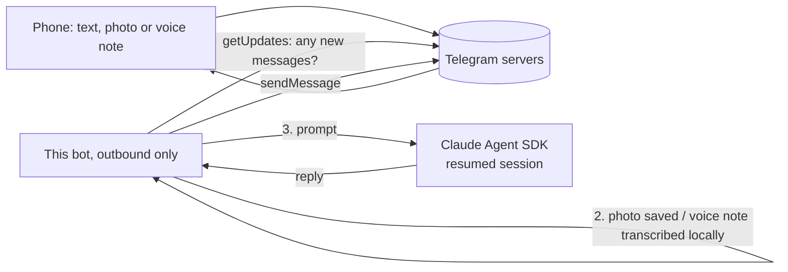

# Telegram AI Assistant Bot

A private two-way chat with Claude on your phone, over Telegram. Send text, a photo or a voice note and get a real answer back, with memory of the conversation, not a one-shot bot that forgets you between messages.

## How it works



1. The bot long-polls Telegram's `getUpdates` endpoint. Every connection starts from your machine and goes out, so there is no webhook, no public URL and no tunnel to run or secure.
2. The sender's numeric Telegram id is checked against `ALLOWED_USER_IDS`. Anyone else gets no reply; only their id and first name are logged, never what they wrote.
3. Text goes straight to Claude. A **photo** is downloaded, handed to Claude to look at, then deleted. A **voice note** is decoded with ffmpeg and transcribed on your own machine with faster-whisper (free, no API), then deleted.
4. The same Claude session is resumed on every message, so a follow-up has the context of everything before it.
5. The reply goes back with `sendMessage`, split if it is over Telegram's 4096-character limit.

## Why this design

- **Long polling instead of a webhook.** Nothing is exposed to the internet, which removes a whole class of problems (tunnels dropping, URLs changing, forged requests). The cost is that the machine has to be on; messages wait at Telegram while it is off.
- **Allowlist, not "reply to everyone".** A bot's username can be found by anyone. Without the allowlist a stranger could run Claude on your machine.
- **Advance the offset before replying.** A crash mid-reply must not replay the same message forever.
- **Text inside a photo or a voice note is treated as data.** The prompt tells Claude never to follow instructions found in an image.
- **Errors never print the bot token.** Telegram puts the token in the request URL, so exceptions are re-raised without it. This was learned the hard way during the build.
- **Failures are reported, not swallowed.** A failed reply tells the user in the chat and calls `alert_failure()`, a hook you can point at email or Slack (default: stderr).

## Setup

```bash
python3 -m venv .venv && source .venv/bin/activate
pip install -r requirements.txt -r requirements-dev.txt
brew install ffmpeg        # needed for voice notes
cp .env.example .env       # then fill it in
```

1. In Telegram, message the verified **@BotFather**, send `/newbot`, and keep the token it gives you. Put it in `.env` as `TELEGRAM_BOT_TOKEN`.
2. Start the bot with no allowlist: `./run.sh`.
3. Send your new bot a message from your phone. It will not answer yet.
4. Read your numeric id from `unknown_senders.log`, put it in `.env` as `ALLOWED_USER_IDS`, and restart. Now it answers.

To keep it running across restarts, wrap `run.sh` in a launchd (macOS) or systemd (Linux) service.

## Tests

```bash
pytest   # 10 tests against a fake local Telegram server, no network, no real bot
```

They cover the allowlist, unknown senders, no replay after a crash, unsupported message types, photo download and cleanup, voice transcription, failure handling and long-reply splitting.

## Status

Built and run live end to end on a real phone: text, a photo and a voice note each went in and a correct answer came back. The test suite passes in a clean environment. Not covered: load, several allowed users chatting at once (messages are handled one at a time), and replies as voice notes (text-to-speech is not built).

## Stack

Python · Telegram Bot API · Claude Agent SDK · faster-whisper · ffmpeg · pytest

---
Part of a small portfolio of tested automation/AI builds; see [ParishSynthMind](https://github.com/ParishSynthMind) for the others.
